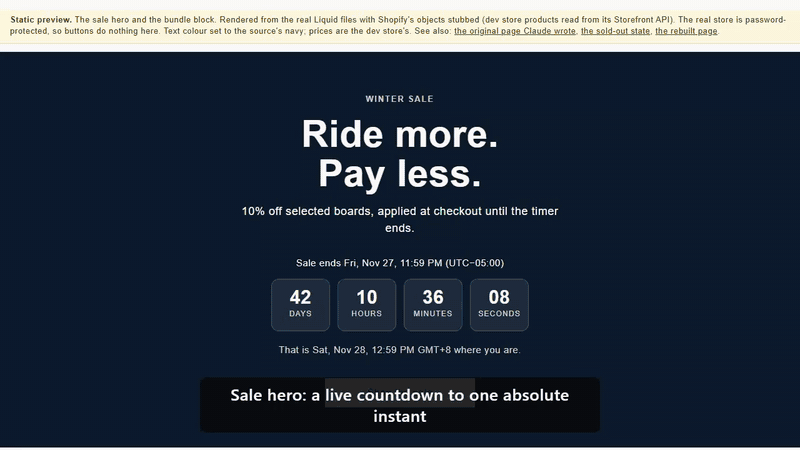

# shopify-theme-lab

[](https://github.com/Exalt24/shopify-theme-lab/actions/workflows/ci.yml)



*The sale hero and bundle block rendered from the real Liquid files: a countdown to one absolute time, then the saving worked out from the actual prices.*

Liquid additions to a Dawn-based Shopify theme on a dev store, plus a measured performance diagnosis. The additions fix gaps the stock theme leaves open.

Proof: `theme check` reports 0 offenses on the sale sections' own files, the countdown tests pass 22 of 22, the Liquid tests 20 of 20 and the spec table tests 7 of 7, and the planted-defect suites catch 15 of 15 and 16 of 16 (runs on 2026-10-12, table in [docs/sale-sections.md](docs/sale-sections.md#how-it-was-checked)).

Store: `dac-dev-store.myshopify.com` (development store, password-protected).
Checked with Shopify's own `theme check` (0 offenses on the sale sections, their CSS, JS, templates and locale keys, under the default configuration; the stock theme has its own, and the older breadcrumb snippet reports one, see "Verifying it") and pushed with the Shopify CLI.

Static copy of the sale sections you can open without the store password: https://sale-sections-preview.pages.dev/ (the page Claude wrote is at `/source`).

## What it is and why

A Dawn-based Shopify theme leaves gaps: the theme emits no BreadcrumbList structured data, a technical catalogue needs a specification table that adds a spec without a theme change, and a sale page written outside the theme cannot be pasted into it. This repo holds those additions as Online Store 2.0 pieces that read the theme's own settings, and a Lighthouse diagnosis of a public storefront that points at third-party scripts rather than image compression. The reference pages below hold the detail, the measured figures and the bugs found on the way.

## New: a Claude-generated page, converted into native Shopify sections (October 2026)

`design-source/winter-sale.html` is a landing page written by Claude (October 2026) as the stand-in for a design handed over: one HTML file, hex colours, English
baked in, a script that runs on `DOMContentLoaded`. It cannot be pasted into a theme. This repo holds its conversion
into editable Online Store 2.0 pieces, and a list of what had to change and why ([`docs/CONVERSION.md`](docs/CONVERSION.md)).

| Piece | File |
|---|---|
| Sale hero with a countdown, editable in the theme editor | `sections/sale-event-hero.liquid`, `assets/section-sale-event-hero.css`, `assets/sale-countdown.js` |
| "What is in the bundle" block for a real bundle product, saving worked out from the real prices | `sections/bundle-contents.liquid`, `assets/section-bundle-contents.css` |
| A sale landing page and a sale collection template | `templates/page.sale-landing.json`, `templates/collection.sale-event.json` |
| Design intent, colour and token mapping, rules to keep | `DESIGN.md` |
| Dev-store data: bundle product, smart collection, page, metafields, a discount ending when the countdown does | `scripts/seed_sale_demo.py` |

The sections take their colours from the theme's colour schemes, end the countdown at one absolute instant, handle a re-render through a custom element, and keep the bundle as its own product with its own price. The full behaviour list with the trade-offs is in [docs/sale-sections.md](docs/sale-sections.md).

## What is in here

| Piece | What it does | Reference |
|---|---|---|
| `snippets/seo-breadcrumb-jsonld.liquid` | BreadcrumbList structured data, which the theme emits nowhere, with absolute URLs from `request.origin` and every value through `\| json` | [docs/seo-and-spec-table.md](docs/seo-and-spec-table.md) |
| `sections/product-spec-table.liquid` | A metafield-driven specification table, so adding a spec needs no theme change, with the specs reaching the theme's own Product node | [docs/seo-and-spec-table.md](docs/seo-and-spec-table.md) |
| `perf/app-cost.mjs`, `perf/audit.mjs` | Third-party cost per origin, and Lighthouse median-of-N against a password-gated dev store | [docs/performance.md](docs/performance.md) |
| The original diagnosis | Lighthouse mobile on a public storefront: performance score 39, LCP 43.0 s, TBT 870 ms, 500 requests, 5,921 KB; two thirds of the weight is third-party | [docs/performance.md](docs/performance.md) |

Reference pages:

- [docs/sale-sections.md](docs/sale-sections.md): what the sale sections do, the check table and what the Liquid tests are and are not
- [docs/storefront-and-preview.md](docs/storefront-and-preview.md): the check on the real storefront and theme editor, and the static preview build
- [docs/overlay-and-own-theme.md](docs/overlay-and-own-theme.md): which stock Dawn files are tracked and how to use the sections in your own theme
- [docs/seo-and-spec-table.md](docs/seo-and-spec-table.md): the breadcrumb snippet, the spec table and the five product pages the layout came from
- [docs/performance.md](docs/performance.md): `perf/` tooling, what was tried and thrown away, and the original diagnosis
- [docs/verification.md](docs/verification.md): `theme check` offense counts, earlier browser checks and why a linter is not a validator
- [docs/STORE_CHECK.md](docs/STORE_CHECK.md) and [docs/CONVERSION.md](docs/CONVERSION.md): the real-store record with screenshots, and what changed in the conversion


## Architecture

The repo is an overlay on Shopify's stock Dawn theme. Most stock files are git-ignored on purpose (see `.gitignore`). The sale sections are two Liquid sections (`sections/sale-event-hero.liquid`, `sections/bundle-contents.liquid`) with one CSS file each, one script (`assets/sale-countdown.js`, a `<sale-countdown>` custom element) and two templates. `scripts/seed_sale_demo.py` seeds the dev store. `tests/` holds the Chromium and LiquidJS suites, `perf/` the measurement scripts and `preview/` the static copy. The tracked stock or edited files and the copy list are in [docs/overlay-and-own-theme.md](docs/overlay-and-own-theme.md).

## Run it

You need the Shopify CLI and a dev store for the push, and Node 20 or newer for the tests and the preview (Playwright 1.64). Node 20.19 or newer is needed for `npm run css` (Sass), Node 22.19 or newer for `perf/audit.mjs` (Lighthouse), and Python 3 only for the seed script and `perf/read_report.py`.

```bash
shopify theme check
shopify theme push --unpublished
npm install
npx playwright install chromium
npm run preview
```

`npm run preview` renders both sections from the real files, fed with the dev store's own product titles, prices and images read from its public Storefront API, and screenshots them at 390px and 1280px with a fixed clock. It needs the stock Dawn files this repo overlays, so run it from a checkout of Shopify's Dawn v9.0.0 or earlier with this repo's files copied over it. The setup, the token variables and what the preview does are in [docs/storefront-and-preview.md](docs/storefront-and-preview.md). To try the sale sections in your own Dawn-based theme, copy only the files listed in [docs/overlay-and-own-theme.md](docs/overlay-and-own-theme.md) and merge the `sections.sale_event_hero` and `sections.bundle_contents` keys into your own locale file. `scripts/seed_sale_demo.py` seeds the author's development store only, and it refuses any other shop.


## Tests

```bash
npm test
npm run test:mutants
npm run test:liquid
npm run test:liquid-mutants
npm run test:spec
```

The tests need Playwright (`npm install`, then `npx playwright install chromium`). Figures from runs on 2026-10-12:

| Check | Result |
|---|---|
| `shopify theme check --output json`, filtered to the sale sections' own files | 0 offenses |
| `node tests/countdown.test.cjs`: Chromium with a controlled clock | 22 of 22 |
| `node tests/countdown_mutants.cjs`: planted defects | 15 of 15 caught |
| `node tests/liquid.test.cjs`: the real section Liquid executed through LiquidJS with Shopify's objects stubbed | 20 of 20 |
| `node tests/liquid_mutants.cjs`: planted defects in the Liquid | 16 of 16 caught |
| `node tests/spec_table.test.cjs` (`npm run test:spec`): the older spec table through LiquidJS | 7 of 7 |

What each case covers, the bug the spec table test found and what the stand-in for Shopify's renderer cannot prove are in [docs/sale-sections.md](docs/sale-sections.md#how-it-was-checked). The `theme check` offense counts for the whole theme are in [docs/verification.md](docs/verification.md).

## Limits

Not done, stated plainly: the editor was read and not used to build or save a page by hand, the sale was not taken
through Shopify's hosted checkout page (the discount was read from a real cart), the quantities of parts in a bundle are
always one, and a bundle with several variants prices its first available one.
The typed-time zone picker offers five fixed offsets (one is a summer-time offset for Sydney and Melbourne; none follows the changeover), so a sale between roughly March and
October should use the collection metafield instead. The colour-scheme options `accent-2` and `background-2` fail
contrast on this store's own colours (`accent-2` #45c0b6 is 2.2:1 against white; `background-2` #6b6b6b is 3.9:1 against black, which fails for body text and passes for large text) (the hero's colour-scheme setting carries a generic hint to check the heading's contrast after changing it). Only English locale keys exist for the new sections.

The performance figures are lab figures under Lighthouse's mobile preset, not field data from real users, and the app-cost figures are an upper bound; both caveats are in [docs/performance.md](docs/performance.md).

## Stack

Liquid on Shopify's Dawn theme, the Shopify CLI and `theme check`, JavaScript tests on Node with Playwright and LiquidJS, Sass, Lighthouse, and Python 3 for the seed script.

## License

This repository is an overlay on Shopify's stock Dawn theme (MIT with Shopify's added condition that it is used to develop themes that work with Shopify; the full text is in `LICENSE`, next to the MIT licence of my additions).
