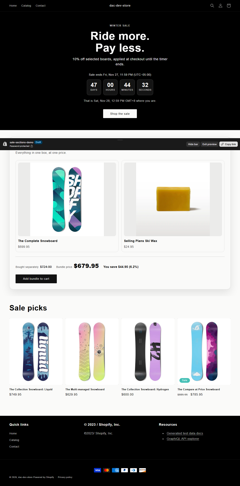
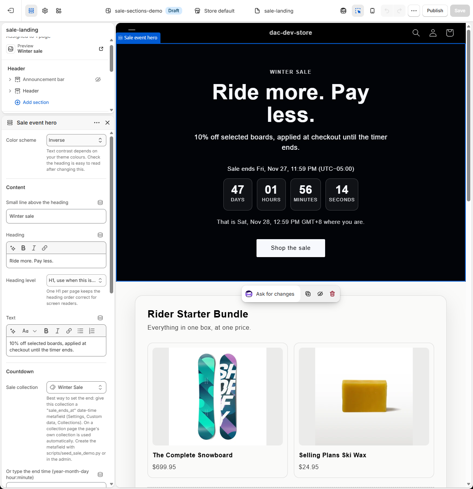
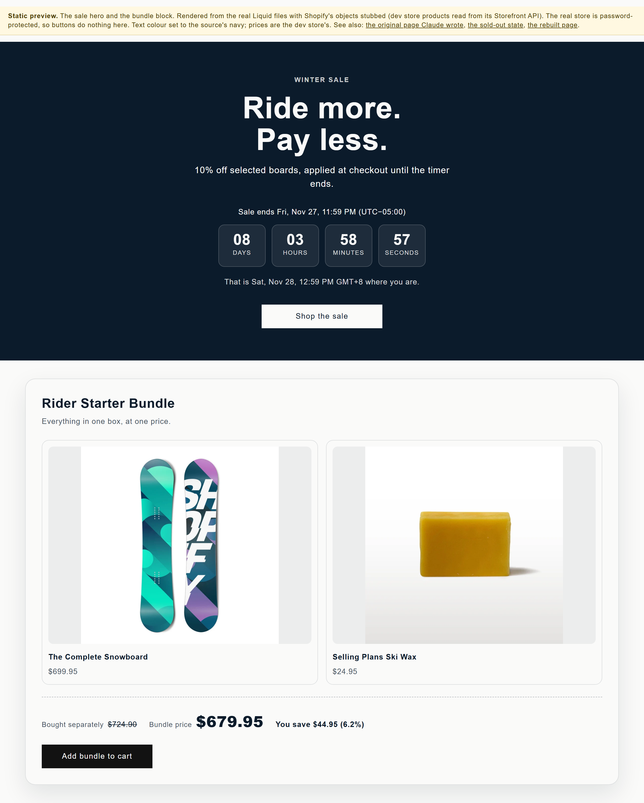
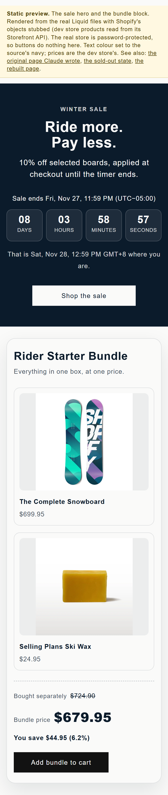

# shopify-theme-lab

Liquid work on a Shopify development store: Liquid additions to a Dawn-based theme
that fix gaps the stock theme leaves open, plus a measured performance diagnosis
of a public storefront.

Store: `dac-dev-store.myshopify.com` (development store, password-protected).
Checked with Shopify's own `theme check` (0 offenses on the files added here; the stock theme has its own, see "Verifying it") and pushed with the Shopify CLI.

---

## New: a Claude-generated page, converted into native Shopify sections (October 2026)

`design-source/winter-sale.html` is a landing page written by Claude (October 2026) as the stand-in for a design handed over: one HTML file, hex colours, English
baked in, a script that runs on `DOMContentLoaded`. It cannot be pasted into a theme. This repo holds its conversion
into editable Online Store 2.0 pieces, and a list of what had to change and why (`docs/CONVERSION.md`).

| Piece | File |
|---|---|
| Sale hero with a countdown, editable in the theme editor | `sections/sale-event-hero.liquid`, `assets/section-sale-event-hero.css`, `assets/sale-countdown.js` |
| "What is in the bundle" block for a real bundle product, saving worked out from the real prices | `sections/bundle-contents.liquid`, `assets/section-bundle-contents.css` |
| A sale landing page and a sale collection template | `templates/page.sale-landing.json`, `templates/collection.sale-event.json` |
| Design intent, colour and token mapping, rules to keep | `DESIGN.md` |
| Dev-store data: bundle product, smart collection, page, metafields, a discount ending when the countdown does | `scripts/seed_sale_demo.py` |

What the sections do that the generated page did not:

- **Colours come from the theme's colour schemes**, so changing a theme colour re-themes them. No hex literals.
- **The countdown ends at one absolute instant.** A sale advertised for a US, UK and Australian audience cannot use
  the visitor's own clock to decide when it ends. The end comes from a collection date-time metafield (best, because
  the collection page and the landing page then agree) or from a typed time plus a chosen zone. The sale's zone is
  always shown, plus the visitor's local time when it differs. With JavaScript off or an unreadable date the section
  still reads correctly.
- **`<sale-countdown>` is a custom element**, so the theme editor's re-render creates and removes timers correctly.
  Impossible dates (31 February, 24:00) are refused identically in every browser; `Date.parse` alone rolls them forward in some.
- **The countdown only counts down.** The seed also creates an automatic discount with the same end instant. The two
  are equal at seed time only: the countdown reads the collection metafield and the discount has its own end date in
  the admin, and Liquid cannot read a discount, so when the sale is moved both must be edited (a Shopify Function
  reading the metafield would tie them).
- **The bundle is its own product with its own price.** The saving is the sum of the parts minus the bundle price,
  shown only when positive. The button is disabled while any listed part is sold out. This is a display guard: a bundle
  product is not stock-linked to its parts the way Shopify's own Bundles app does it (an order contains only the bundle
  line, so the parts' stock does not drop, and a direct cart add or a stale cached page can still sell it), and a
  discount that varies by cart needs a Shopify Function or a bundle app. "Bought separately" is the parts' list
  price, so the parts must stay out of any discounted collection: a review found that tagging the parts into the
  10% sale made the page say "You save" while the parts were cheaper than the bundle, and the seed now keeps them out.

- **The look follows the store's theme, not the original page.** The rebuilt hero takes the theme's colour scheme (black on this store's Dawn colours, navy in the static copy where the text colour is set to the source's navy) and the button is the theme's own button. The original's amber pill button, gradient and three-card product grid are not rebuilt; `docs/CONVERSION.md` lists each difference.

How it was checked (figures from runs on 2026-10-12):

| Check | Result |
|---|---|
| `shopify theme check --output json`, filtered to the files added here | 0 offenses. |
| `node tests/countdown.test.cjs`: Chromium with a controlled clock | 22 of 22. It caught a real bug of mine in the local-time line while it was being written. |
| `node tests/countdown_mutants.cjs`: planted defects | 15 of 15 caught (timer leaks, ignored zone offset, wrong day length, no end state, HTML injection, accepted impossible dates, listener leaks, and others) |
| `node tests/liquid.test.cjs`: the real section Liquid executed through LiquidJS with Shopify's objects stubbed | 20 of 20: saving maths, whole-number percent, sold-out part and sold-out bundle, no saving row when the bundle is not cheaper, the metafield instant reaching the script as the same moment in six render zones, collection priority, escaping, heading level, image priority, every string present in the locale file. |
| `node tests/liquid_mutants.cjs`: planted defects in the Liquid | 16 of 16 caught |

**What the Liquid tests are and are not.** `tests/render/shopify_liquid.cjs` is my own stand-in for the Shopify
objects, filters and tags the two sections use (`money`, `t`, `image_url`, ``, ``, a date filter
that prints a time in a given offset). It runs the real `.liquid` files, so the branches and maths are exercised, but
it is not Shopify's renderer. The two things it cannot prove, how Shopify prints a `date_time` metafield and how the
theme editor behaves, were checked on the real store the same day (below). The section prints the offset it was
rendered in precisely so the end moment is right either way, and the tests check that for six zones.

**Checked on the real Shopify storefront and theme editor (2026-10-12).** The files of this repo were pushed to a
development store's unpublished theme and read there in a real browser; the record, with screenshots, is
[`docs/STORE_CHECK.md`](docs/STORE_CHECK.md). Short version: the landing page and the collection template render with
no missing translations or overflow; Shopify prints the `date_time` metafield in the shop's zone and `%:z` gives its
offset (`23:59:00-05:00`), so the end moment is right; a Manila browser reads "Sat, Nov 28, 12:59 PM GMT+8" and a Sydney
one "3:59 PM GMT+11"; with JavaScript off the static label and the bundle still read correctly; a real cart shows the
10% automatic discount on the sale board ($749.95 to $674.96) and none on the bundle or its parts; with every variant of
the wax at zero stock the button reads Sold out, and the inventory was restored exactly; a theme colour change
carries through to the hero and the bundle heading; the theme editor lists both sections, shows their settings, and
offers them in the Add section list; a theme font change carries through to both sections; Lighthouse (mobile, cold, five
runs) has a median of 91, and the weight is Shopify's and Dawn's own scripts and stylesheets (the three files these sections
add transfer 5.2 KB); axe finds nothing inside either section at 390px and 1280px.




**A static copy anyone can open (the dev store itself is behind its password).** `npm run preview` renders both sections from those real files, fed
with the dev store's own product titles, prices and images read from its public Storefront API, styled with the theme's
own `base.css` and colour settings, and screenshots them at 390px and 1280px with a fixed clock. The result is
`preview/index.html` (open it in a browser) with `preview/phone-390.png` and `preview/laptop-1280.png`. In the run of
2026-10-12 the sale zone and a visitor's own time both show (a Manila browser reads "That is Sat, Nov 28, 12:59 PM
GMT+8 where you are."), the saving reads "You save $44.95 (6.2%)" against the parts' list prices, and there is no
horizontal overflow at either width.

The preview needs the stock Dawn files this repo overlays (`assets/base.css`, `config/settings_data.json`), so run it
from a checkout of [Shopify's Dawn](https://github.com/Shopify/dawn) (MIT) with this repo's files copied over it, then
`npm install` there. Use Dawn v9.0.0 or earlier: later Dawn replaced the flat colour settings this repo's sections and
the preview builder read (`colors_text`, `colors_accent_1`, ...) with colour-scheme groups, and on such a checkout the
builder warns and falls back to a plain palette (the sections themselves expect the older colour-scheme classes). It
stops without changing anything if the two Dawn files are missing. It reads the dev store's public Storefront token from
`SHOPIFY_STOREFRONT_TOKEN` (or a file named by `SHOPIFY_STOREFRONT_TOKEN_FILE`) and falls back to stub products
without one; Node 18 or newer is needed (global `fetch`), Python 3 only for the seed script.
Its buttons and product links are inert, its product images are hot-linked from the dev store's CDN, its countdown
ends at the fixed instant 2026-11-28T04:59:00Z (after which it shows the ended state), and the theme's text colour is
set to the source design's navy to show that a colour setting carries through. It is deployed to Cloudflare Pages
as the project `sale-sections-preview`.




Not done, stated plainly: the editor was read and not used to build or save a page by hand, the sale was not taken
through Shopify's hosted checkout page (the discount was read from a real cart), the quantities of parts in a bundle are
always one, and a bundle with several variants prices only its first.
The typed-time zone picker offers five fixed offsets (no daylight-saving ones), so a sale between roughly March and
October should use the collection metafield instead. The colour-scheme options `accent-2` and `background-2` fail
contrast on the default preset (the hero section warns about it in its settings). Only English locale keys exist for the new sections.

This repository is an overlay on Shopify's stock Dawn theme (MIT, see `LICENSE`). Most stock files are git-ignored on
purpose (see `.gitignore`), but a few edited or stock files are tracked because earlier work changed them:
`sections/main-product.liquid`, `templates/product.json` and the full `locales/en.default.json` (stock keys plus the
keys I added). To try the sale sections in your own Dawn-based theme, copy only `sections/sale-event-hero.liquid`,
`sections/bundle-contents.liquid`, `assets/sale-countdown.js`, `assets/section-sale-event-hero.css`,
`assets/section-bundle-contents.css` and the two `templates/*sale*.json`, and merge the `sections.sale_event_hero` and
`sections.bundle_contents` keys into your own locale file rather than copying mine over it.
`scripts/seed_sale_demo.py` seeds MY development store only (it refuses any other shop and uses Shopify's sample
product handles), so on another store create the two metafield definitions (`custom.bundle_items`,
`custom.sale_ends_at`) and the discount by hand. The tests need Playwright: `npm install`, `npx playwright install chromium`, then `npm test`
and `npm run test:mutants`.

---

## What is in here

### 1. `snippets/seo-breadcrumb-jsonld.liquid`

BreadcrumbList structured data, which the theme emits nowhere. Product,
Organization and WebSite schema were already present; BreadcrumbList was missing,
and it is the one Google renders **inside the result**, replacing the raw URL path
with `Store > Collection > Product`.

Three decisions worth reading the file for:

- **The middle crumb comes from `collection`, not from the URL.** Shopify serves
  the same product at `/products/x` and `/collections/y/products/x`, and only the
  second knows which collection the visitor came through. `collection` is set on
  that route and nil on the bare product URL, so the crumb appears exactly when it
  is true. Deriving a category from the handle would produce structured data that
  contradicts the page, which is worse than none.
- **Absolute URLs via `request.origin`.** Google drops a relative `item`, and
  hardcoding a domain rots the moment the theme is previewed elsewhere.
- **Every value goes through `| json`.** A product title containing an inch mark,
  which in a technical catalogue is routine, otherwise produces invalid JSON and
  takes the whole block down.

A bug `theme check` caught in the first version, worth knowing: the home crumb used
`'general.breadcrumbs.home' | t | default: 'Home'`, and that key does not exist in
the theme's locales. **The `default` filter does not save you**, because a missing
translation renders the literal string `Translation missing: en.general...`, which
is not blank, so `default` never fires. Google would have been served that text as
the breadcrumb name on every page. It now uses `shop.name`, which needs no locale
file and matches the Organization node the theme already emits.

### 2. `sections/product-spec-table.liquid`

A metafield-driven specification table for catalogues where the specs matter:
purity, particle size, dimensions, tolerance, connector.

The usual approach pastes specs into the product description as an HTML blob,
which cannot be filtered, compared, exported, or marked up, because it is prose.
This renders whatever lives in a metafield namespace, so **adding a spec needs no
theme change**, and groups rows under headings from a `prefix__key` convention so
an existing catalogue needs no migration to keep working.

The specs reach structured data through the theme's **own** Product node in
`sections/main-product.liquid`, not a second one. The first version emitted its own
`{"@type":"Product","@id":"...#product","additionalProperty":[...]}` on the belief
that Google merges nodes sharing an `@id`. **The theme's real Product node has no
`@id` at all**, so nothing matched and the page shipped two Product entities, the
second with no `name`, which is the single field Product requires. The live page
confirmed it before the fix: `Product nodes on page: 2`.

Two more bugs worth knowing, both of which looked fine until they did not:

- **Liquid compares `false` equal to `blank`.** A ``
  guard therefore dropped every boolean spec whose value was false, and the "No"
  branch was unreachable. On a technical catalogue, "Hazardous: No" is the row that
  most needs to be there.
- **The JSON-LD serialised raw values** while the visible HTML went through a type
  switch, so exactly the types the switch existed to protect against reached
  structured data as Shopify objects like `{"value":12.0,"unit":"MILLIMETERS"}`.
  Both paths now share `snippets/spec-value.liquid`, so they cannot disagree again.

### Layout came from reading five real PDPs, not from taste

Captured at 1440px and 390px: DigiKey, Edmund Optics, Fisher Scientific,
McMaster-Carr, and an industrial-supplies storefront in the same space.

- **The pair stays side by side at every width.** McMaster holds a 38/62 split at
  374px. Stacking on mobile, which this did under 480px, turns a 20-spec table into
  a 40-row scroll on the device where scanning is hardest. Measured effect of the
  fix: the block went from 365px tall to 212px at 390px.
- **The value carries the contrast, not the label.** McMaster and Edmund disagree
  about how to treat the label and agree completely on this. Mine was backwards.
  The value now uses the theme's own `--color-foreground` variable rather than a
  hardcoded hex, so a merchant's colour scheme still works.
- **The list is capped to a readable measure.** Fisher runs a 296px label inside a
  651px container. Uncapped, this grid put the value 350px from its own label at
  1280px and read as two unrelated columns.
- **Nothing truncates.** McMaster renders 31 rows with no show-more; Fisher is the
  only site in the set that collapses, and it hides Percent Purity behind a click
  on a purity-driven product.

**Deliberately not copied:** DigiKey's four-column zebra grid. Two independent
pairs per row means a screen reader linearises unrelated specs into one sequence.

**Kept against all five references: the `<dl>`.** Not one of them uses one, and not
one associates a header cell, so a screen reader on DigiKey, Edmund, Fisher and
McMaster hears a value with no idea which column was the name. Being more correct
than the references is the right call when they are all wrong the same way.

The Liquid detail that bites everyone: iterating a metafield namespace yields
`[key, metafield]` pairs where the second item is a **Metafield drop, not a
string**. Printing it directly works for text fields and prints an object for a
dimension or a rating, so the value goes through a `case` on `field.type`. It looks
correct until the day someone adds a typed field.

Renders nothing at all when the namespace is empty, so it can sit in the default
product template without leaving an orphan heading on products that have no specs.

### 3. `perf/`: measurement tooling, and one thing that did not work

**`perf/app-cost.mjs` is the useful one.** It attributes bytes and main-thread time
to each third-party origin on a page, which turns "optimize Core Web Vitals" into a
list sorted by cost. Run against a public Shopify storefront it produced this (the raw
reports are not committed, because they name that store; rerun the script against
any public product page to reproduce the method):

| Origin | KB | CPU ms |
|---|---|---|
| googletagmanager.com | 1,985 | 206 |
| the store itself | 2,119 | 166 |
| scripts.clarity.ms | 73 | 106 |
| powr.io | 50 | 56 |
| klaviyo (5 origins) | 142 | 35 |

Third party came to **3,697 KB and 457 ms of CPU against the store's own 166 ms**,
64% of the bytes on the page. One tag manager container was 1,985 KB.

It separates Shopify's own platform scripts from apps, because counting the
platform as app cost inflates every number and points a merchant at savings they
cannot have. It deliberately does not recommend removals: whether a review widget
earns 800 KB is a revenue question, not a bytes question.

**`perf/audit.mjs`** runs Lighthouse against a password-gated development store,
which a plain `npx lighthouse` cannot do: the store 302s to /password and you end
up auditing a login form and reporting a lovely score for it. It logs in INSIDE the
browser Lighthouse drives (an earlier version forwarded a cookie header from another
browser, which Shopify's redirects defeated, and scored the password page: 7 requests and
82 KB for a page that really makes about 140), clears the cache between runs, and refuses
any run that did not end on the page it was asked for. It also runs N times and
reports the median, because a single run varies by several points and a
before/after built from one run each can show a win that is entirely noise.

#### What I tried and threw away

I attempted a synthetic before/after: simulate a typical app-laden store, apply
deferral and interaction-loading, measure the difference. **It produced three
mutually inconsistent results and I deleted it**, because a number I cannot account
for is worse than no number.

The three reasons it failed are each worth knowing:

1. **The Shopify CLI honours `.gitignore` on push.** A gitignored snippet is never
   uploaded, and Liquid renders a MISSING snippet as empty **with no error**, so the
   feature silently does not exist while the page looks fine.
2. **Shopify minifies theme JS assets.** A 700 KB payload padded with comments
   arrived as **286 bytes**, so the first run measured nothing at all.
3. **Storefront HTML is CDN-cached and a cache-busting query parameter does not
   reliably bust it.** After pushing a change, the live page still served the old
   markup, so two variants measured the same cached page twice.

Also worth recording: **Liquid cannot read query parameters.** `request` has no
query object, and while `content_for_header` contains the full URL in the served
HTML, matching it at render time did not work either. Both failures were silent.

### 4. The original diagnosis

Lighthouse against a **public Shopify storefront**, mobile emulation,
simulated throttling (150 ms RTT, 1.6 Mbps, 4x CPU slowdown):

| Metric | Value |
|---|---|
| Performance score | 39 |
| LCP | 43.0 s |
| TBT | 870 ms |
| CLS | 0.062 (the one thing that is fine) |
| Requests | 500 |
| Transferred | 5,921 KB |
| Scripts | 135 requests, 3,263 KB |
| Third party | 175 requests, 3,896 KB |
| Unused JavaScript | 1,368 KB, 8.3 s estimated saving |
| Main-thread script evaluation | 5,441 ms |

The diagnosis those numbers support: **two thirds of the transferred weight is
third-party**, and 5.4 seconds of main-thread script evaluation is what pushes LCP
out, so the win is not image compression, it is auditing which apps still earn
their script tag. CLS being fine matters too, because it means the layout is not
the problem and effort spent there would be wasted.

Stated honestly: these are **lab** figures under Lighthouse's mobile preset, not
field data from real users. Field data would come from CrUX or a `web-vitals`
beacon, and lab numbers under 4x CPU throttling are deliberately pessimistic.

---

## Verifying it

```bash
shopify theme check                     # my two files: zero offenses
shopify theme push --unpublished        # pushed to the dev store
```

`theme check` on the two additions reported 48 remaining offenses across 44 files, all pre-existing in the stock
theme. Re-run on 2026-10-12 with the sale sections added, the whole theme reports 495 offenses: 480 are
`MatchingTranslations` (450 are the 15 keys of the sale sections, present only in `en.default.json` and not in the 30 other
locale files, 30 are one stock key) and the rest are the stock ones. The new files themselves report 0.

The rendered output IS verified, in a real browser at 1280px and 390px: the spec
table renders as a `dl` with real metafield values, the breadcrumb emits a valid
two-item trail on a product page and nothing at all on the home page, exactly one
Product node carries the specs, and there is no horizontal overflow or console
error at either width.

It needed the storefront password entered by hand, because a development store
gates everything: `theme dev`, `theme share` and the preview URL all sit behind
it and no Admin API mutation exists to lift it.

**A linter is not a validator.** `theme check` passed a file that `theme push`
then rejected outright, because Liquid does not allow a filter inside an `if`
condition. The rejected file silently stayed at its previous version on the
store, so the browser check kept showing the old output and it looked like the
fix had not worked.
